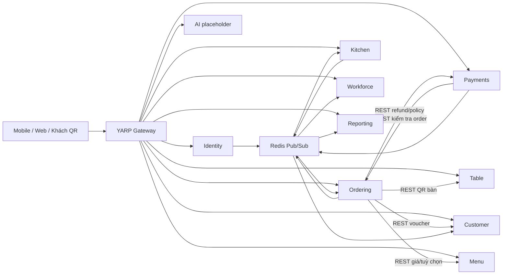

# Audit kiến trúc Backend main — 2026-11-03

## Kết luận và phạm vi

Backend hiện tại là **9 API .NET 8 + API Gateway YARP + AI FastAPI**, không phải 10 API .NET đang có nghiệp vụ như một số đoạn README cũ. Không còn project Inventory trong solution hiện tại. Có 4 project test .NET và một nhánh AI model standalone riêng.

Đã đối chiếu solution/project references, Program, DbContext/ModelSnapshot, route registration, policy và các luồng Auth/Order/QR/Kitchen/Payment; đọc OpenAPI đang chạy để kiểm kê **268 cặp method/path**. Không tuyên bố đã chạy mọi nhánh nghiệp vụ hoặc review từng dòng toàn repo.

Source chính: main `d7ab6b7cb25634a2fb4635c10ebeb9232db27534`. Chỉ đọc source và GET tài liệu OpenAPI trong audit; không migration/seed/API ghi, tạo account/JWT, đổi credentials/ACL hoặc restart container. Tài liệu triển khai trước đó: [database](MAIN_DATABASE_DEPLOYMENT.md), [runtime](MAIN_RUNTIME_EXECUTION.md).

Ba tài liệu để đọc:

1. File này: kiến trúc, module, luồng và các điểm cần xử lý.
2. [Danh mục 268 API và DTO](BACKEND_API_CATALOG.md): method/path, quyền, input/output OpenAPI, source handler.
3. [Đối chiếu Mobile](MOBILE_MAIN_API_MAPPING.md): màn nào có API, phần nào khác contract và thứ tự tích hợp.

## Kiến trúc thực tế

Sơ đồ thể hiện các cạnh chính, không liệt kê mọi client gọi Identity để kiểm tra branch/user/plan. Service gọi REST trực tiếp tên service/cổng nội bộ, không vòng qua Gateway.

### Tổ chức code

- `src/Gateway/AICOS.Gateway`: YARP routing, JWT validation, CORS, rate limit, correlation ID, metrics và platform health.
- `src/BuildingBlocks/AICOS.BuildingBlocks`: auth/policy, current user/tenant/branch, EF base context, audit interceptor, ProblemDetails, HTTP resilience/client, Redis cache/hash/event bus.
- `src/BuildingBlocks/AICOS.Contracts`: integration events dùng chung, không chứa business database của service khác.
- Mỗi API là **một project theo feature**: `Features`, `Domain`, `Persistence`, `Infrastructure`/`Services`, `Program`. Endpoint thường dùng DbContext trực tiếp; không phải kiến trúc tách project Domain/Application/Infrastructure cho từng service và không có generic repository bắt buộc.
- API projects không có ProjectReference trực tiếp sang project API khác trong kiểm tra solution; dùng BuildingBlocks/Contracts và HTTP/events để giao tiếp.

Đây là microservices theo database/service và deployment riêng, với feature modules bên trong từng service. Shared libraries/event contracts vẫn tạo phụ thuộc version khi thay đổi; không đồng nghĩa mọi service đã độc lập vận hành production.

## Các module và API đã có

Operations bao gồm `_info`, không tính health/docs/hub/Gateway. Có endpoint không đồng nghĩa đã test E2E thành công.

| Module | Ops | Chức năng có implementation trong source |
| --- | ---: | --- |
| Identity | 65 | Login/refresh/logout/me, signup xác minh OTP, Google login, chọn brand, quản lý session, user/branch/tenant, brand tự đăng ký và duyệt, profile brand/contact, subscription/limits/payments, audit, platform |
| Menu | 18 | Category/product CRUD, option groups/options, menu công khai theo branch, publish/availability/price override |
| Table | 19 | Khu vực, bàn/floor plan, batch tạo/copy layout, trạng thái bàn, QR regenerate/QR SVG, public lookup QR |
| Ordering | 40 | Đơn tại quầy, DineIn/Takeaway/Delivery, detail/list/payment/receipt, đổi loại phục vụ, hủy/no-show/unfulfillable/exception, pickup slots, QR shared cart/session/bill, feedback/recommendation |
| Payments | 29 | Provider và merchant config, transaction/cash/query/simulate, webhook HMAC, cancellation policy, refund approve/reject, reconciliation |
| Kitchen | 7 | Queue/batch/ticket detail, chuyển trạng thái, cup stickers, remake; push SignalR |
| Workforce | 49 | Hồ sơ nhân viên, ca/phân ca, attendance, ca thay thế/đăng ký/duyệt, quy tắc lương/tính lương/điều chỉnh, cash closing/cash transactions |
| Reporting | 7 | Báo cáo chuỗi/chi nhánh, export, payment methods và peak hours; dữ liệu projection từ events |
| Customer | 29 | Customer/profile/preferences/loyalty, rule tích điểm, voucher validate/redeem/redemption, thông báo khách và nhân viên |
| AI runtime | 5 | `_info` và 4 POST placeholder: chat, attendance verify, forecast, summary |

Tổng: **268**; **127 GET / 141 non-GET**. Trừ 10 `_info` còn 258 operation, trong đó 4 AI placeholder trả 501 khi vượt qua xác thực. Không nên nói cả 268 đã hoàn thiện production.

### Gateway và real-time

- Gateway proxy 10 prefix `/api/v1/{identity,menu,tables,orders,payments,kitchen,workforce,reporting,customers,ai}` và `/hubs/kitchen`, `/hubs/orders`.
- Gateway có GET `/`, `/health/live`, `/api/v1/platform/health` (SuperAdmin). Không có Swagger tổng hợp hoặc `/health/ready` tổng hợp ở source hiện tại.
- `/hubs/kitchen`: JWT, `JoinKitchenGroup` cho Barista/BranchManager/BrandAdmin; `JoinPosGroup` cho Cashier/BranchManager/BrandAdmin. Group chứa tenant/branch; staff chỉ branch của mình.
- `/hubs/orders`: khách QR dùng `sessionToken`, Customer dùng access JWT. Hub kiểm tra session/member ownership để vào group; push `OrderChanged`/`SessionClosed`. Không phải một hub staff theo dõi toàn chi nhánh mặc định.
- JWT query `access_token` chỉ được đọc cho path `/hubs`; QR hub dùng tham số khác là `sessionToken`. Chưa test negotiate/WebSocket trong audit.

## Database ownership

Một PostgreSQL instance Docker, **database-per-service**, bên trong mỗi database lại có schema riêng. `POSTGRES_DB=aicos` là prefix/bootstrap, không phải một database chứa toàn bộ bảng nghiệp vụ.

| Service | Database | Schema | Bảng nghiệp vụ | Cột |
| --- | --- | --- | ---: | ---: |
| Identity | aicos_identity | identity | 10 | 132 |
| Menu | aicos_menu | menu | 5 | 47 |
| Table | aicos_table_reservation | table_reservation | 2 | 24 |
| Ordering | aicos_ordering | ordering | 6 | 92 |
| Payments | aicos_payment | payment | 6 | 90 |
| Kitchen | aicos_kitchen | kitchen | 3 | 37 |
| Workforce | aicos_workforce | workforce | 9 | 126 |
| Reporting | aicos_reporting | reporting | 1 | 16 |
| Customer | aicos_customer | customer | 7 | 89 |
| AI | aicos_ai | ai | Chưa có bảng nghiệp vụ | vector extension |

49 bảng / 653 cột nghiệp vụ; cộng 9 bảng EF history thì 58 bảng / 671 cột ở 9 database .NET. 44 migrations theo triển khai đã kiểm tra. Init main tạo 10 login roles, mỗi role sở hữu database của mình; đã test chặn connect chéo database. Không có FK hoặc join SQL trực tiếp chéo service như thiết kế `public` cũ.

Bảng chính:

- Identity: `users`, `user_sessions`, `otp_codes`, `tenants`, `branches`, `audit_logs`, `subscription_plans`, `tenant_subscriptions`, `subscription_payments`, `contact_messages`.
- Menu: `categories`, `products`, `option_groups`, `product_options`, `branch_products`.
- Table: `dining_tables`, `table_areas`.
- Ordering: `orders`, `order_items`, `order_item_options`, `order_feedbacks`, `pickup_slot_settings`, `table_sessions`.
- Payments: `payments`, `payment_providers`, `merchant_settings`, `payment_webhook_events`, `payment_refunds`, `cancellation_policies`.
- Kitchen: `kitchen_tickets`, `kitchen_ticket_items`, `cup_stickers`.
- Workforce: `employees`, `employee_shifts`, `work_shifts`, `replacement_shifts`, `replacement_applications`, `pay_rules`, `payroll_adjustments`, `cash_transactions`, `cash_closings`.
- Customer: `customers`, `loyalty_transactions`, `loyalty_rules`, `vouchers`, `notifications`, `staff_notifications`, `staff_notification_reads`.
- Reporting: `order_facts`.

EF sử dụng Npgsql/snake_case, schema cố định và bảng history riêng trong schema service. `AuditableEntity`/interceptor ghi created/updated actor/time; không phải mọi thay đổi tài chính đều có append-only payment ledger như BE cũ. Identity có audit append-only với bảo vệ trong context/trigger.

## Xác thực và phân quyền

Role thực tế là `SuperAdmin`, `BrandAdmin`, `BranchManager`, `Barista`, `Cashier`, `Customer`, `Guest`. Không có `Waiter`, `Manager`, `WarehouseStaff` trong danh sách role .NET chính hiện tại.

| Policy | Role được cấp |
| --- | --- |
| PlatformAdmin | SuperAdmin |
| AdminOnly | BrandAdmin |
| Management | BrandAdmin, BranchManager |
| Staff | BrandAdmin, BranchManager, Barista, Cashier |
| AvailabilityEditors | BrandAdmin, BranchManager, Barista |
| AuditViewer | SuperAdmin, BrandAdmin |

`CounterRoles` của Order/Payment là BrandAdmin/BranchManager/Cashier; `BarRoles` là Barista/BranchManager/BrandAdmin. Kitchen PUT status có policy Staff ở route nhưng handler chỉ BarRoles được Brewing/ReadyForPickup/Completed; hủy ticket chỉ manager/admin. Vì vậy không suy quyền cuối cùng chỉ từ tên policy ngoài route.

JWT HS256 dùng key chung, kiểm tra issuer/audience/lifetime/signature, clock skew 30 giây. Claims có `sub`, `name`, `role`, `tenant_id`, `branch_id`, `sid` theo ngữ cảnh. Runtime local dùng issuer `aicos-main`, audience `aicos-main-clients`; không ghi key vào tài liệu.

- `TenantScope.Require` yêu cầu tenant; SuperAdmin không mặc nhiên đọc business của mọi brand. Platform API là nhánh riêng.
- `BranchAccess` và directory kiểm tra branch/tenant. BrandAdmin có thể lọc toàn chuỗi hoặc chọn branch; staff gắn branch trong JWT. Một role hợp lệ vẫn có thể bị 403/404 khi sai tenant/branch/ownership.
- Login request là `{login,password}`; trả access/refresh tokens + expiry UTC + user + optional activeBrandCode. Không phải contract login cũ `{account,password,branchId}`.
- Staff có tenant/branch được gán trên user. Customer là tài khoản global, xác minh email hoặc Google; chọn brand bằng flow riêng để lấy ngữ cảnh tenant. Không tự coi customer login là staff login.
- Refresh token lưu hash theo session; login sai có thể ghi failed attempts/lockout, login đúng ghi session và audit. Logout/revoke session chặn refresh; access JWT đã cấp vẫn dùng tới expiry vì service validate stateless, không hỏi Identity mỗi request. Nếu yêu cầu thu hồi tức thì thì phải thiết kế thêm, không giả định đã có.
- Google/SMTP có code tích hợp nhưng cần cấu hình ngoài source; runtime hiện chưa có account/fixtures nên chưa test flow thật.

Source: `AicosSecurity.cs`, `AuthenticationExtensions.cs`, `TenantScope.cs`, `BranchAccess.cs`, Auth/SignUp/Session endpoints và `AuthTokenIssuer.cs`.

## Luồng nghiệp vụ cốt lõi

### Gọi món tại quầy và mang về

POST `/api/v1/orders` dành cho CounterRoles; request nhận productId/quantity/note/optionIds, type và dữ liệu bàn/khách tùy trường hợp. Backend đọc menu/giá hiện hành và tính surcharge, không tin tổng tiền từ Mobile. Voucher được kiểm tra/đổi qua Customer service. Lưu order rồi publish event cho Kitchen/Reporting/notifications.

Main hỗ trợ Delivery trong enum, nhưng sản phẩm Mobile hiện chỉ cần DineIn/Takeaway. Không cần bật thêm giao hàng trên UI chỉ vì Backend có.

Pickup khách hàng là flow riêng POST `/orders/pickup`, slot capacity/time window/idempotency và payment deadline; không nên dùng nhầm cho mọi đơn mang về của thu ngân.

### Khách order bằng QR

1. Public lookup QR của Table, rồi POST `/orders/qr/scan` để mở/join session.
2. Nhận sessionToken/sessionId/tenant/branch/table; các request guest gửi `X-Table-Session`.
3. Giỏ chung Redis hash, quantity thao tác atomic; giá lấy lại từ Menu. Redis cart có TTL.
4. Checkout tạo Order DineIn và `AttachToTableSession(session.Id)`; khách Customer đã chọn đúng brand có thể gắn customerId.
5. Khách đọc orders/bill của phiên, yêu cầu thu ngân tính tiền hoặc lấy payment-access token giới hạn phiên. Staff dùng list session và bill theo sessionId qua JWT Staff.

Bill tổng phiên là aggregation trong Ordering, không phải bảng `bills/bill_items` riêng như BE cũ. Manual staff CreateOrder hiện chỉ nhận TableId/TableNumber, không có TableSessionId và không tự gọi AttachToTableSession trong handler; cần chốt/test cách thêm lượt của staff vào phiên QR để bill không thiếu order.

### Bar/Kitchen

Kitchen tiêu thụ OrderCreated/PaymentSucceeded và các event cancel/complete/bill-request, lưu projection ticket của mình. Trạng thái Pending → Brewing → ReadyForPickup → Completed hoặc Cancelled, có rule theo loại đơn/đã thanh toán. DineIn và Takeaway có điều kiện eligibility khác nhau.

Bar đổi trạng thái bằng API có kiểm tra role; pub/sub đưa trạng thái về Ordering và SignalR thông báo POS/KDS. Sẵn sàng pha chế, giao món và thanh toán là những trạng thái riêng, không dùng lẫn nhau.

### Payment/Refund

- Cash: kiểm tra order/amount/branch qua REST, tạo payment Succeeded, lưu rồi publish PaymentSucceeded/CashPaymentRecorded. Cashier actor và amount tendered/change được xử lý trong source.
- Online: tạo transaction qua provider/merchant config, lấy checkoutUrl, trạng thái pending; query/webhook/expiry/refund xử lý tập trung.
- Webhook không cần JWT nhưng bắt buộc HMAC và amount khớp; có unique providerCode/eventId cho chống event trùng. Đây không phải xác nhận thu ngân đã thấy tiền vào tài khoản.
- Tất cả provider đang đăng ký `SimulatedGateway`, kể cả VietQR/Momo/ZaloPay. VietQR có thể sinh ảnh QR thật nhưng query/refund vẫn mô phỏng trạng thái nội bộ, không gọi ngân hàng thật. `AllowSimulation=false` chỉ khóa flow simulate theo cấu hình, không biến adapter thành ngân hàng thật.
- Refund có policy/approval/reconciliation và event cập nhật Order, Customer, Reporting. Chưa có provider integration thật nên không coi response success mô phỏng là tiền thật đã hoàn.
- Chưa thấy endpoint QR manual-confirm kèm bằng chứng nhận tiền như yêu cầu BE cũ; cần thống nhất trước khi triển khai thu ngân thực tế.

## REST, events và consistency

HTTP clients chuyển tiếp bearer token/correlation ID; có standard resilience/timeouts. Không thấy client credentials riêng cho mọi service-to-service call; gọi từ background không có HttpContext cần kiểm tra khả năng xác thực theo flow. Không kết luận mọi call nền sẽ lỗi vì nhiều handler chỉ dùng dữ liệu event/local DB.

| Nguồn → Đích | Vai trò chính |
| --- | --- |
| Các business service → Identity | Branch/user/plan lookup, tenant/branch scoping |
| Ordering → Menu/Customer/Table/Payment | Giá/menu, voucher, QR lookup, refund/policy |
| Payment → Ordering | Order identity, trạng thái và amount trước giao dịch |
| Workforce → Ordering | Thông tin exception khi xem cash closing |
| Identity events → Customer/Identity audit | Registration/profile/privacy, notifications/audit |
| Ordering events → Kitchen/Customer/Reporting | Ticket, thông báo, điểm/voucher, order facts |
| Payment events → Ordering/Kitchen/Reporting/Workforce | Paid/refund, bar eligibility, doanh thu, tiền mặt |
| Kitchen events → Ordering/Customer | Preparing/ready/remake và thông báo |

Redis Pub/Sub là fire-and-forget, subscriber catch/log lỗi nhưng không retry persisted. Không thấy bảng outbox/inbox trong model hiện tại. DB SaveChanges và publish không cùng transaction liên service; consumer offline/exception có thể để projection lệch. Mỗi handler có mức idempotency khác nhau; không tuyên bố event exactly-once. Reconciliation đã có một phần API nhưng chưa chứng minh tự phục hồi mọi luồng.

## Contract dữ liệu cho client

- JSON camelCase; enum là chuỗi ở API; IDs UUID, thời gian UTC ISO. Mobile format giờ Việt Nam/tiền/thời lượng tại lớp trình bày.
- Phần lớn tiền lưu numeric(18,0), khác schema cũ numeric(18,2); không truyền chuỗi định dạng `110.000đ` vào field amount.
- Có paging `{items,page,pageSize,totalCount}`, maxPageSize 100 ở helper chung; một số endpoint trả list/limit riêng. Không giả định mọi GET list đều có cùng envelope.
- Lỗi RFC7807 `application/problem+json`, thường có `title`, `status`, `detail`, `errorCode`, `correlationId`, validation `errors`. Mobile cần map mã lỗi sang tiếng Việt; không lấy mọi lỗi từ field `message`.
- OpenAPI có 62 operation không khai báo typed response schema; một số handler trả 201/204 khác khai báo tự sinh 200. Contract cho adapter phải xác minh record/handler, không chỉ generate client từ Swagger.

## Các phát hiện cần ưu tiên

| Mức | Phát hiện có bằng chứng source | Tác động/việc cần làm |
| --- | --- | --- |
| Cao | Staff CloseSessionAsync đóng luôn, không kiểm tra paid; automatic CloseIfSettled có check nhưng đường manual không dùng. TableSessionExpiryWorker cũng đóng theo idle mà không kiểm tra settlement | Khác yêu cầu không đóng bàn khi chưa thanh toán. Chốt rule và test cả manual/auto/expiry, không coi paid guard đã phủ mọi đường |
| Cao | Receipt GET gọi MarkAsPrinted/SaveChanges; Kitchen stickers GET gọi SaveChanges; payment detail GET có ExpireIfDue | Không dùng các GET này làm preview/read-only/retry tự động. Printed flag chưa chứng minh máy in thật đã thành công |
| Cao | GatewayRegistry dùng SimulatedGateway cho mọi provider; default MockWebhookSecret có trong source | Chưa đủ cho tiền thật. Tách sandbox/real, secret quản lý riêng và xác minh bằng chứng/provider thật trước production |
| Cao — cần test tái hiện | Cash handler read existing rồi insert; payment index TenantId/OrderId không unique, không thấy concurrency token/transaction khóa tương ứng | Có nguy cơ cash concurrent tạo 2 payment. Chưa chạy mutation/concurrency test trong audit, không kết luận đã có giao dịch trùng thực tế |
| Cao | Lưu DB rồi publish Redis Pub/Sub không có outbox persisted | Mất event có thể làm payment/order/Kitchen/reporting lệch; cần reliability/reconciliation tests trên PostgreSQL/Redis thật |
| Trung bình | Manual order TableId không tự gắn TableSessionId | QR session bill có thể không gom các lượt tạo từ quầy; cần contract rõ cho Chi tiết bàn/Gọi thêm món |
| Trung bình | Logout/revoke chỉ vô hiệu refresh, JWT vẫn tới expiry | Cần thống nhất chính sách force logout/khóa nhân viên, không giả định revoke tức thì ở mọi service |
| Trung bình | Swagger thiếu schema/status cụ thể, một số quyền quan trọng ở handler | Cần bổ sung contract và tests trước auto-generate client/enable nút Mobile |
| Trung bình | AI runtime role names còn SystemAdmin/Manager/WarehouseStaff, khác .NET main; model service standalone chưa nối | Không mặc định AI dùng được với staff JWT main hoặc coi model code là đã deploy |
| Tích hợp | Không có Waiter và Bill CRUD tương đương demo; Order DTO có cashierId nhưng không cashierName | Chốt role/DTO với UI, không dùng mock name làm dữ liệu thật hoặc mở quyền quản lý user cho cashier để tra tên |

Source trọng điểm để xem lại: `QrOrderEndpoints.CloseSessionAsync`, `TableSessions.CloseIfSettledAsync`, `OrderEndpoints.PrintAsync`, `KitchenEndpoints.StickersAsync`, `PaymentEndpoints.RecordCashAsync/GetAsync`, `PaymentProcessor`, `Gateways.cs`, `PaymentsDbContext`, `RedisEventBusSubscriber`, `SessionEndpoints.cs`.

Các mục là kết quả static review và đối chiếu contract; không phải báo cáo pentest hoặc bằng chứng tất cả race đã được tái hiện. Không sửa code/schema trong lượt audit này.

## Hai phần AI khác nhau

1. `src/Services/Ai`: FastAPI đang được Gateway gọi. 4 nghiệp vụ raise 501, readiness chỉ TCP; không có inference thật trong các handler này.
2. `ai-models/service/app.py`: standalone có chat/chat stream, feedback analyze, recommendations và models metadata. Có code load ONNX/recommender/Barista, dùng sample menu ở `ai-models/common/menu.py`; chưa được Gateway hiện tại nối vào, auth chưa được gộp và có model/provider prerequisites. Không chạy hoặc tải model lớn trong audit.
Không nói toàn bộ AI trong repo đều không có code, cũng không nói bộ model đã trở thành AI service production. Cần tích hợp API/role/tenant/menu thật và kiểm tra model artifacts riêng.

## Tests và độ sẵn sàng

- 4 test projects .NET: BuildingBlocks.Tests, Services.SmokeTests, IdentityOrganization.Tests, Services.IntegrationTests.
- IdentityApiFactory và TestKit dùng EF InMemory, fake Google/clients/cache/clock, recording event bus. Tên IntegrationTests không có nghĩa đó là PostgreSQL/Redis thật hoặc E2E qua Gateway.
- Runtime trước đó đã kiểm tra Docker build, 9 role/DB sessions, model schema, GET health/metadata, JWT âm và dữ liệu rỗng. Tham chiếu MAIN_RUNTIME_EXECUTION.md; không nâng các check đó thành login/cash/refund business PASS.
- Lượt này chỉ đọc OpenAPI và source, không chạy lại business test suite hoặc tạo fixture; không tính test chưa chạy/skip là PASS.

Backend đủ cấu trúc và API để bắt đầu tích hợp có kiểm soát. Chưa đủ bằng chứng để đưa toàn bộ thanh toán thật, phục vụ đông khách hoặc AI vào production. Nên làm Identity account/tenant/branch trước, rồi Menu/Table, Ordering/Kitchen, cuối cùng Payment sau khi chốt các gap tài chính.
