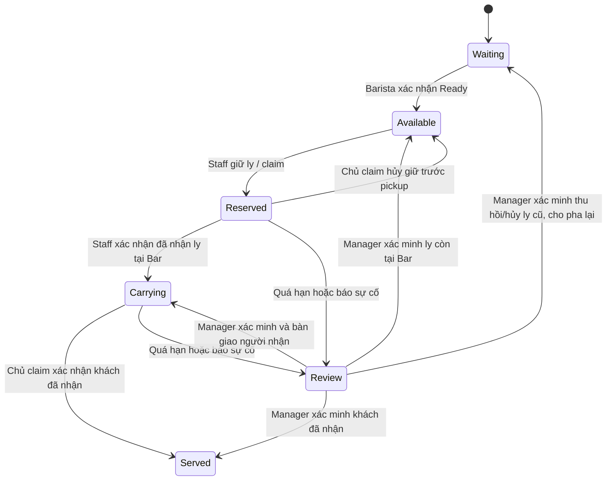

# Item-level Serving và Multi-Staff Claim — đề xuất để duyệt

**Sau phê duyệt có điều kiện:** [review và foundation increment](CUP_SERVING_CONDITIONAL_APPROVAL_REVIEW.md) là trạng thái hiện tại. Đã code core/storage/guards và chuẩn bị EF migrations, giảm schema từ 5+2 xuống **4+2** do gộp audit vào operation ledger. Phần dưới là đề xuất gốc để đối chiếu; không dùng dòng DESIGN ONLY lịch sử hoặc API đề xuất làm kết luận feature đã mở. Public flow/E2E/DineIn vẫn BLOCKED.

Ngày đối chiếu source: 2026-11-07. **DESIGN ONLY / BLOCKED pending approval.** Không có tính năng, DTO, bảng, migration, worker hoặc token mới được triển khai trong lượt này. Không kết nối DB, chạy SQL/migration/seed, deploy, restart container hoặc commit/push. Các thay đổi code còn trong working tree là của lượt trước.

## 1. Kết luận từ code hiện tại

| Source thực tế | Khả năng / giới hạn |
| --- | --- |
| Ordering `Domain/Entities/OrderItem.cs`, `Features/Orders/OrderContracts.cs` | OrderItem có GUID, quantity/options/note; OrderItemResponse đã trả Id. Không có trạng thái mỗi đơn vị quantity |
| Contracts `OrderEvents.cs`: OrderItemDto | Không có OrderItemId; không phân biệt hai dòng cùng product/name khi replay |
| Contracts `KitchenAdmission.cs` | Admission v1 không có line ID/mode/unit ID. Hash v1 sắp payload món, không bao gồm các ID này; không được sửa hash v1 tại chỗ |
| Ordering `Features/KitchenAdmission/AdmissionOutbox.cs` | Có outbox, consumer key/version, immutable creation payload và checkpoint. Bar note legacy ghép options/note, giới hạn 300 ký tự |
| Kitchen `Domain/Entities/KitchenTicket.cs` | Status/RemakeCount nằm trên cả ticket; KitchenTicketItem chỉ product/name/quantity/note. CupSticker có ID/CupIndex nhưng không có OrderItemId hoặc trạng thái giao |
| Kitchen `Features/KitchenTicketWrites.cs`, `KitchenTicketTransitions.cs` | Khóa tenant/order và conditional updates bảo vệ writer, không đại diện cho quyền giữ ly của Staff |
| Ordering `Features/Orders/OrderDeliveryEndpoints.cs`, `Order.Deliver` | Giao toàn Order, một DeliveredAtUtc/DeliveredBy; domain yêu cầu Order Ready, hoàn tất legacy khi đã paid. Không có claim/custody từng ly |
| Kitchen `KitchenOrderDeliveredHandler`, `KitchenOrderCompletedHandler`, admission `ApplySource` | Event/DeliveredAt của cả Order có thể complete ticket; cần guard mode để không ghi đè ly chưa giao |
| Ordering `Features/Qr/QrOrderEndpoints.cs`: TableSessions.CloseIfSettledAsync | Phiên có thể tự đóng khi các lượt đã paid/refunded, không xét Serving. Đây là blocker triển khai DineIn thực tế, không sửa phần này trong thiết kế |
| Mobile `models/serving_task.dart`, `DemoServingRepository`, `ServingTaskCard` | Demo dùng tableCode/orderCode/itemIndex làm ID và so sánh tên assignee. Chỉ state RAM, theo dòng, không dùng cho API mode |
| Mobile `MainOperationsRepository.deliver`, `MainOrder.canDeliver`, `MainOrderDetailView` | Một nút xác nhận cả Order, quyền Counter; chưa có API/DTO claim hoặc màn serving theo từng ly |
| Kitchen `KitchenStickerEndpoints`, Mobile `MainKitchenStickerPreview` | Preview tem chỉ đọc, có hold guard; chưa có printer ACK. CupIndex/PrintedAtUtc không phải bằng chứng ly đã sẵn sàng hoặc đã giao |

Đọc cùng GAP/progress/design trong Mobile và `STAFF_ORDER_REMAINING_OPERATIONS_RESULT.md`, `KITCHEN_ADMISSION_RECOVERY_IMPLEMENTATION.md` trong Backend. Các số test 18 recovery/9 operations/461 regression ở báo cáo trước là **lịch sử**, không kiểm chứng thiết kế mới này. Không có repository Web hoạt động được xác minh trong lượt này.

## 2. Phương án MVP đề nghị và thay đổi so với đề xuất cũ

Đề xuất cũ `PerLineV1` trong Mobile giao toàn bộ quantity của một dòng; không đáp ứng yêu cầu mới. Thay bằng **CupV1: một đơn vị quantity = một tác vụ phục vụ độc lập**, kể cả hai ly giống hoàn toàn. Không chuyển đổi Order legacy tự động.

| Lựa chọn ownership | Ưu / nhược | Đề nghị |
| --- | --- | --- |
| Ordering giữ claim, Kitchen giữ prep | Giữ gần đề xuất cũ, nhưng ready/remake/cancel và claim nằm ở hai DB; đọc snapshot rồi claim không đủ atomic, cần durable reservation/ACK giữa hai service | Không chọn làm MVP vì tăng handshake và trạng thái phục hồi |
| Kitchen giữ prep + claim + giao từng ly; Ordering giữ projection phi tài chính | Cùng transaction kiểm tra ready, hold, cycle, owner và claim. Ordering không đọc DB Kitchen; chỉ nhận snapshot có version/ACK | **Đề nghị duyệt**, không tạo service mới |

Đây là **đề xuất đổi ownership của Serving từng ly**, không phải thay đổi đã áp dụng. KitchenOperations quản lý vòng đời món và bàn giao thực tế; Ordering tiếp tục sở hữu Order/OrderItem, phiên bàn, số lượng bán và chế độ fulfillment. Chỉ Kitchen được ghi trạng thái từng ly; projection Ordering không có quyền cấp claim hoặc làm lại món.

Phạm vi MVP: các Staff Order mới opt-in, DineIn/Takeaway được Backend cho phép; POS/QR/Web không tự bị chuyển mode. Một đơn có thể được A giao ly 1, B giao ly 2. Không dùng thao tác giao cả dòng làm giả serving từng ly. Không thêm role Waiter: Staff giao món dùng Cashier/BranchManager/BrandAdmin hiện có; Barista pha chế, không tự nhận quyền giao khách.

## 3. Định danh ly và invariant

- Định danh nguồn: `(tenantId, orderId, orderItemId, unitIndex)`, unitIndex từ 1..Quantity. CupId là UUID v5 từ namespace/version cố định và chuỗi GUID canonical của tuple; cần golden tests trước code. ID này là định danh, không phải secret/quyền truy cập.
- Cùng một dòng 3 bạc xỉu tạo C1/C2/C3 khác CupId. Dòng khác cùng sản phẩm cũng khác OrderItemId nên không đụng nhau. Replay/restart giữ ID; không dùng product name, thời gian, thứ tự JSON hoặc local itemIndex để match.
- V2 manifest sắp OrderItemId canonical, rồi unitIndex, xác định orderCupIndex 1..tổng quantity ổn định. Thứ tự UI có thể khác nhưng số tem không đổi sau replay/chuyển bàn. Không áp quy tắc mới lên tem/Order legacy.
- CupId là nhu cầu phục vụ logic. Pha lại tăng preparationCycle, không đổi CupId, không xóa lịch sử claim/served. Không pha lại ly Served trong MVP; khiếu nại/đền món là luồng khác, chưa duyệt.
- Mỗi cup có đúng một current cycle, tối đa một claim còn giữ quyền; mỗi cup được xác nhận Served một lần trong fulfillment hiện tại. `servedCount = count(cup Served)`, không nhập tay count.
- Với phần chưa có cancellation workflow: `total = waiting + ready + reserved + carrying + served + review`; các bucket loại trừ nhau. Chỉ complete fulfillment khi `served == total > 0`, không còn hold/review. Không coi ly chưa pha/hủy chưa duyệt là đã giao.
- Mỗi cup lưu source options/note snapshot; không có giá tiền, payment status hoặc bill ID trong task/claim. Một combo fixed-price hiện tại vẫn là một sale unit; muốn tách cà phê/hotdog thành hai thành phần cần component manifest riêng, **chưa có và không được tự suy từ tên combo**.

## 4. State machine và quy trình

Tách hai trục và hold riêng, tránh một enum trộn pha chế với bàn giao:

| Trục | Trạng thái / quy tắc |
| --- | --- |
| Preparation | Pending → Brewing → Ready; Barista/Manager ghi người và thời điểm từng bước |
| Serving | Waiting → Available → Reserved → Carrying → Served |
| Review/hold | Có ticket recovery hold hoặc cup review thì chặn prep/claim/pickup/serve/reprepare; không tự xóa hold từ polling/replay |
| Claim | Reserved → Carrying → Served; Reserved có thể Released trước pickup; Reserved/Carrying quá hạn → Overdue, giữ quyền và chờ kiểm tra; Manager có thể close bằng Released/Overridden/Served sau kiểm chứng |



`Review` trên sơ đồ là review flag + state/claim lưu trước đó, không xóa lịch sử. Served không có đường quay về Available. Sự kiện legacy không được tự complete CupV1.

Quy trình bình thường:

1. Order commit + admission v2 outbox cùng transaction, tạo nhu cầu N cup từ Quantity. Kitchen receiver commit ticket/items/cups/receipt/tem liên kết trong một transaction rồi ACK.
2. Barista bắt đầu và hoàn thành **cup cụ thể**. Ready cập nhật task, version và outbox thông báo; chưa complete cả ticket khi còn cup đang pha.
3. Staff chọn “Giữ ly” → server cấp claim. UI chỉ hiển thị thành công sau response; người khác thấy ai đang giữ và không nhận trùng.
4. Staff xác nhận “Đã nhận từ Bar” với claim/cycle/version hợp lệ. Đây là thời điểm ghi custody Carrying; claim trước đó chỉ là giữ chỗ, chưa chứng minh cầm ly.
5. Sau khi khách nhận đúng ly, Staff “Đã giao khách”. Server commit Served + actor/time + audit + snapshot outbox; không gọi Payment/Bill hoặc close session.
6. Khi tất cả cup Served, Kitchen ghi FulfillmentComplete, Ordering nhận projection. Gọi thêm món tạo Order/ticket/cup mới, không tăng lại số ly của Order cũ.

Ticket CupV1 giữ aggregate legacy Status tương thích và trả thêm cup summary. Pending/Brewing/ReadyForPickup được tính từ các cup chưa hoàn tất pha, Completed chỉ khi tất cả đã Served. Trường hợp một ly đã giao, một ly đang pha hiển thị `PartiallyServed` ở fulfillment summary, không thêm enum legacy mà client cũ không hiểu.

## 5. Timeout, custody và Manager override

**Đề nghị lease 120 giây, renew mỗi 30 giây khi app foreground**, giá trị cần duyệt/configure, thời gian quyết định từ server/DB. Renew tăng version, không đổi owner/cycle. GET/heartbeat không được gia hạn ngầm; retry cùng operation key không kéo dài lease lần nữa.

Không tự trả cup về Available khi hết lease, kể cả Reserved: Staff có thể đã cầm ly nhưng POST pickup bị mất trước commit. Không có phần mềm nào biết chắc vị trí vật lý chỉ từ timeout. Worker và command guard đều kiểm tra deadline; worker trễ không cho claim cũ tiếp tục hợp lệ.

- Timeout → Overdue + cup review, claim vẫn chiếm quyền; người khác nhận 409. Không auto-claim lại/auto-serve/auto-release khi app tắt hoặc logout.
- Release bình thường chỉ cho **owner ở Reserved, còn lease, chưa pickup**, với xác nhận ly vẫn ở Bar. Carrying muốn trả món phải báo sự cố và Manager kiểm chứng vật lý.
- Manager kiểm tra expectedVersion/cycle/claim fence và nhập reason/evidence: `AtBar`, `HandoverConfirmed`, `CustomerReceived`, `OldCupDisposed`, hoặc `Unknown`. Unknown chỉ giữ review, không resolve thành Available/Served.
- Resolve `AtBar`: đóng claim cũ, trả Available. `HandoverConfirmed`: đóng claim cũ và cấp claim mới/fence mới trong cùng transaction; cần xác minh target Staff còn active, đúng tenant/branch và đúng role qua Identity contract hiện có hoặc API đọc cần bổ sung nếu thiếu.
- Resolve `CustomerReceived`: ghi Served theo hành động xác nhận của Manager, lưu cả người báo và người duyệt; không gán giả actor của Staff. Resolve `OldCupDisposed`: chưa Served, thu hồi/loại ly cũ và duyệt reprepare → tăng cycle, Pending/Waiting, claim cũ bị fence.
- Response thất lạc sau commit: Staff tra cứu operation/cup rồi dùng lại key ban đầu, không tạo key mới và không tự nhận thêm ly. Response replay là kết quả lịch sử; client phải đối chiếu current version/custody trước thao tác vật lý tiếp theo.
- Nếu đã giao khi offline, app lưu **ý định/chưa xác nhận**, không hiển thị server Served. Nếu claim chuyển Overdue/đã bị override, báo sự cố để Manager xác nhận; không backdate server audit hoặc tự vượt fence.

## 6. Concurrency, idempotency và audit

MVP dùng common advisory transaction lock tenant/order hiện có trong Kitchen, thêm row/version check cho task và claim. Hai Staff có thể claim hai cup khác nhau; transaction ngắn serialize trong cùng Order, không giữ lock suốt thời gian nhân viên mang món. Các Order khác vẫn chạy đồng thời.

Một command: xác minh JWT/tenant/branch/role → vào transaction/lock → reload ticket/task/active claim → đọc hoặc ghi operation key → kiểm tra hold/mode/cycle/version/fence/deadline/owner → mutate + audit + outbox + lưu result → commit → trả response. Không gọi HTTP/Redis trong transaction. Multi-cup command chưa cần ở MVP; UI nhận nhiều cup bằng command riêng, hiển thị kết quả từng cup, không báo tất cả thành công khi có cup conflict.

Lấy một timestamp DB `clock_timestamp()` **sau khi đã lấy lock** để so deadline và ghi audit cho command; không dùng thời gian client hoặc transaction-start time từ trước lúc chờ khóa. Claim/release/renew/timeout/override của cup đều dùng cùng protocol.

- Unique partial index một claim active/cup gồm Reserved/Carrying/Overdue. Không dùng `now()` trong predicate; expiration được xử lý bằng state và kiểm tra deadline trong transaction.
- Numeric bigint Version là EF concurrency token; command bắt buộc expectedVersion và expectedPreparationCycle. Claim có fence bigint tăng khi cấp lại/override; claim ID/token cũ không còn quyền dù Staff vẫn giữ response cũ.
- Một user hai thiết bị cũng không pickup/serve lại với key khác. Cùng key/cùng payload trả cùng effect; khác route/cup/claim/payload trả 409 `operation.key_reused`. Scope key theo tenant + actor + operation key; request hash bao gồm command/route/resource/body canonical.
- Replay phải kiểm tra quyền/scope trước khi đọc ledger. Chỉ ACK command sau DB commit. Không dùng Redis lock/cache làm authority.
- Audit append-only trong cùng transaction: actor từ JWT, hành động, cup/order/claim/cycle/version trước-sau, reason/evidence, correlation/operation key và server time. Không dùng Pub/Sub làm nơi lưu duy nhất. Không ghi JWT/password hoặc secret machine key.
- Nếu writer phục hồi execution strategy, retry cả transaction, reload state; unique constraint và operation ledger quyết định kết quả, không chỉ bắt exception rồi trả 200.
- Mọi effect cup/claim/review tăng ticket `fulfillment_version` trong cùng transaction và ghi snapshot outbox theo version này. Không dùng version riêng của hai cup làm aggregate version vì có thể trùng hoặc đảo thứ tự.

## 7. Schema và EF migrations đề xuất — chưa tạo hoặc chạy

Source main hiện map service schema `ordering` và `kitchen`; không dùng mô hình `public` của Backend backup. Chưa kết nối DB để kiểm tra drift; schema thực tế phải preflight sau khi được duyệt riêng. Không FK xuyên service hoặc tới Identity.

| Service / thay đổi | Dữ liệu chính / constraint |
| --- | --- |
| Ordering `orders` thêm fulfillment_mode | WholeOrder default cho legacy, CupV1 chỉ server opt-in; không sửa quantity/price/payment/bill/session |
| Kitchen `kitchen_tickets` thêm fulfillment_mode, fulfillment_version, source_table_id, source_session_id | WholeOrder default, version bigint ≥ 0; table/session ID nullable, snapshot nguồn không FK sang service khác; không tạo lại unique tenant/order hiện có |
| Kitchen `kitchen_ticket_items` thêm nullable order_item_id | Unique `(ticket_id, order_item_id)` WHERE non-null; legacy giữ null, không match theo tên |
| Kitchen **cup_tasks** mới | CupId PK; tenant/branch/order/ticket/item/source OrderItemId, unitIndex/orderCupIndex, source manifest hash, product/options/note snapshot, prepState, servingState, cycle, version, fence, created/updated/ready/pickup/served actor/time, review reason. Unique source tuple và `(ticket_id, order_cup_index)`; FK ticket/item trong Kitchen, RESTRICT; checks positive index/cycle, versions ≥0, enum và Served phải có served actor/time |
| Kitchen **cup_claims** mới | Id, cupId, ownerUserId, cycle/fence, state, version, created/lease/pickedUp/ended timestamps, request identity. FK cup nội bộ; unique active cup; indexes tenant/branch/owner/state và state/deadline |
| Kitchen **cup_operations** mới | OperationId/key/actor/tenant, command/resource, request hash, response/effect snapshot, committedAt; unique tenant/actor/key, không expire tự động khi chưa duyệt retention |
| Kitchen **cup_audit** mới | Append-only event ID + cup/claim/actor/action/version/cycle/reason/evidence/time; indexes cup/time, branch/time; actor không FK Identity |
| Kitchen **fulfillment_outbox** mới | EventId, tenant/branch/order, aggregate version, immutable summary/hash, state, nextAttempt, lease/fence/attempt/error/ACK. Unique order/version/consumer; due index; không dùng Published Redis làm ACK |
| Kitchen `cup_stickers` thêm nullable cup_task_id | FK local cup, unique WHERE non-null, legacy null. Giữ sticker IDs/PrintedAtUtc; không tạo lại existing indexes. Preview thêm CupId/cycle, không coi đó là hardware ACK |
| Ordering **order_fulfillment_projection** mới | PK/scoped order identity, source ticket/mode/manifest hash/version, total/prep/serving/review counters, fulfilledAt/last performer summary và lastVerifiedAt. FK Order nội bộ; checks count không âm/không vượt total |
| Ordering **fulfillment_receipts** mới | producer/consumer/EventId PK, order/version/hash/appliedAt/result, FK projection/Order nội bộ; cùng event khác hash conflict |

Tổng đề xuất: **5 bảng Kitchen + 2 bảng Ordering**, thêm cột ở các bảng liệt kê. Chưa chốt tên physical/index cho tới migration review. Không cần bảng cup trong Ordering vì nguồn định danh là OrderItemId + ordinal; Kitchen giữ authoritative task, Ordering chỉ summary, không nhân đôi ownership.

Không đặt FK currentClaimId ngược từ cup tới claim để tránh vòng FK: query live claim qua unique active index; task state và claim state phải đổi cùng transaction. Cross-row invariants không thể chỉ bảo đảm bằng CHECK một hàng; bắt buộc command handler + PG concurrency tests và reconciliation kiểm tra integrity.

EF plan, tất cả additive, tên dự kiến chứ **không phải migration đã tồn tại**:

1. `Ordering_CupFulfillmentExpand`: mode + projection/inbox, default legacy, chưa enable capture v2.
2. `Kitchen_CupServingExpand`: mode/version/correlation + 5 bảng + nullable sticker FK; giữ v1 receipts/indexes.
3. Backfill chỉ mode/default cho legacy theo script được duyệt; **không chuyển legacy cup/claim/served history**. Kiểm tra dữ liệu trước thêm unique correlation; bảng mới ban đầu rỗng.
4. Nếu cần tách contract validation/index online thì tạo migration riêng `Ordering_CupFulfillmentConstraints` / `Kitchen_CupServingConstraints` sau validation; không sinh migration giả chỉ để đủ số bước. Review SQL generated/locking/checksum/rollback trước apply.

Chưa cấp quyền mới. Cần duyệt quyền SELECT/INSERT/UPDATE đúng bảng mới cho service owner; audit/inbox/outbox không cấp write cho Staff trực tiếp, không dùng role superuser. Không thay ACL hiện tại trong lượt này. Giữ MigrateOnStartup=false.

## 8. API / DTO đề xuất

Tất cả path dưới đây **chưa tồn tại**. Public commands dùng Staff JWT, `Idempotency-Key`, expectedVersion/preparationCycle; custody commands kèm claimId/fence. Không nhận owner/actor từ client. Counter role = Cashier/BranchManager/BrandAdmin; Manager = BranchManager/BrandAdmin, cùng tenant/branch.

| API | Request chính | Quyền |
| --- | --- | --- |
| GET `/api/v1/kitchen/serving/cups?branchId=&orderId=&state=&cursor=&limit=` | Paging, limit mặc định 30/tối đa 100 | Staff xem trong scope |
| GET `/api/v1/kitchen/serving/cups/{cupId}` | — | Staff trong scope |
| PUT `/api/v1/kitchen/serving/cups/{cupId}/preparation` | target Brewing/Ready, expectedVersion/cycle | Barista/Manager |
| POST `/api/v1/kitchen/serving/cups/{cupId}/claims` | expectedVersion/cycle | Counter; owner = JWT.sub |
| POST `/api/v1/kitchen/serving/claims/{claimId}/renew` | expectedVersion/cycle/fence | Owner, chưa quá hạn |
| POST `/api/v1/kitchen/serving/claims/{claimId}/release` | expectedVersion/cycle/fence, reason/atBar confirmation | Owner, Reserved hợp lệ |
| POST `/api/v1/kitchen/serving/claims/{claimId}/pickup` | expectedVersion/cycle/fence | Owner, Reserved hợp lệ |
| POST `/api/v1/kitchen/serving/claims/{claimId}/serve` | expectedVersion/cycle/fence, confirmedCustomerReceived | Owner, Carrying hợp lệ |
| POST `/api/v1/kitchen/serving/cups/{cupId}/issues` | observedVersion, issue/reason, related operation | Staff báo; không tự quyết định kết quả |
| POST `/api/v1/kitchen/serving/cups/{cupId}/resolve` | expectedVersion/cycle/fence, decision, reason, evidence, optional targetStaffId | Manager; thay owner tạo fence mới |
| GET `/api/v1/kitchen/serving/operations/{operationId}` | — | Actor hoặc Manager trong scope |
| GET `/api/v1/orders/{id}/fulfillment` | Summary/projection freshness | Staff trong scope |
| POST `/internal/v1/ordering/fulfillment-snapshots` | Machine-scoped snapshot + event/hash/version | Kitchen machine identity riêng |
| GET `/internal/v1/kitchen/fulfillment-snapshots?cursor=&limit=` | Bounded scan/snapshot | Ordering reconciliation identity |

GET capabilities hiện có mở rộng additive `cupServingVersion`, `claimVersion`, supported modes; không đổi conditionalTicketUpdatesVersion. Create Order opt-in mode phải được server/branch capability cho phép, caller không thể tự ép bằng field. Default mọi caller cũ vẫn WholeOrder.

Ví dụ DTO cup, các GUID minh họa được rút gọn, không phải fixtures đã tạo:

```json
{
  "cupId": "C2", "ticketId": "T1", "orderId": "O1", "orderItemId": "I1",
  "fulfillmentMode": "CupV1", "orderCode": "BK-50",
  "unitIndex": 2, "lineQuantity": 3, "orderCupIndex": 2, "orderTotalUnits": 3,
  "productName": "Bạc xỉu", "customizations": "Size L · 50% đường · Ít đá",
  "tableId": "S02-ID", "tableCode": "S02", "sessionId": "SESSION-1",
  "preparationState": "Ready", "servingState": "Reserved",
  "preparationCycle": 1, "version": 8, "reviewReason": null,
  "claim": {"id": "CL1", "ownerUserId": "USER-A", "ownerName": "Thùy Linh",
    "fence": 2, "state": "Reserved", "leaseExpiresAtUtc": "2026-11-07T08:02:00Z"},
  "serverTimeUtc": "2026-11-07T08:00:00Z"
}
```

Mutation response trả `operationId`, `replayed`, `operationResult` đã commit và `cup` snapshot hiện tại được đọc dưới lock; replay không trả snapshot lease cũ như thể còn quyền. Không trả bill/payment mutation. UI nhận tên chỉ để hiển thị; quyền so sánh UserId. Error codes đề xuất: `serving.claimed`, `serving.stale`, `serving.lease_expired`, `serving.not_owner`, `serving.cycle_changed`, `serving.review_required`, `operation.key_reused`, `order.cup_serving_required`. 401/403/404 scope như hiện tại; 409 conflict-state, 422 invalid transition, 503 chưa lấy được dependency. Không biến 409 thành success local.

## 9. Kitchen Recovery / Sticker / đồng bộ bền vững

**Admission:** giữ v1 payload/hash/receipt nguyên trạng. Đề xuất v2 receiver (schemaVersion=2, consumer key riêng `kitchen-order-admission-v2`) thêm fulfillmentMode, OrderItemId và structured options/note; canonical hash có ID/quantity/options và version. Không thêm field vào hàm hash v1 rồi đổi hash của outbox cũ.

- V2 source facts thêm tableId/sessionId để lưu đúng lượt khách; không suy từ tableCode hoặc current session của bàn. Capture chọn đúng một protocol theo mode, không tạo cả v1 và v2 cho cùng CupV1. Reconciliation/checkpoint phải tách consumer v1/v2; không nâng version một outbox/receipt đã ACK.
- Không nhận create opt-in nếu cấu hình atomic capture v2 chưa sẵn sàng; Order và outbox phải commit cùng nhau. Kitchen đang offline không phải lý do bỏ capture hoặc từ chối Order đã được phép: dispatcher/recovery nhận lại sau. Structured options giữ giá trị nguồn; không dựa vào BarNote legacy đã cắt 300 ký tự để phân biệt cup, cần chốt giới hạn snapshot text v2 ở contract review.
- Backend dual-reader v1/v2 phải được deploy tới **tất cả Kitchen replicas trước** khi cho phép CupV1. Old binary bỏ qua marker mới và có thể tạo ticket WholeOrder, nên không cho mixed old writers khi bật mode.
- OrderCreated legacy cho CupV1 cần optional mode marker, consumer mới không tạo ticket v1/auto-print khi nhận marker CupV1; durable v2 mới có quyền admission. Legacy orders vẫn xử lý như cũ. Web/Reporting đọc field cũ không đổi; không xóa Redis legacy event.
- Replay v2 tra tuple/CupId/unique keys, không reset cycle/Served/claim/lease; receipt + ticket + cup + linked sticker commit atomically rồi ACK. V1/v2 cùng order nhưng mode/manifest conflict → review, không âm thầm nâng mode hoặc tạo ticket thứ hai.
- Receipt APPLIED không đồng nghĩa được phục vụ: thao tác vẫn kiểm tra ticket/cup hold hiện tại. Reconciliation không tự clear hold từ aggregate Order.DeliveredAt/Completed cho CupV1; source legacy không có bằng chứng từng ly.
- Các Order có trước rollout ở WholeOrder. Không map CupIndex legacy với OrderItemId bằng suy tên hoặc sắp lại items. Backfill per-cup lịch sử là workflow review khác, chưa duyệt.

**Fulfillment forward:** cup command và Kitchen outbox summary commit cùng transaction; dispatcher HTTP machine-to-machine tới Ordering, lease/fencing/backoff, ACK đúng event/order/version/hash sau inbox+projection commit. Không dùng Pub/Sub để bảo đảm delivery. Snapshot chứa counts/theo tối đa 50 dòng + manifest hash và source version, không gửi lại toàn bộ 4.950 cup trong một message.

Ordering projection chỉ nhận snapshot authoritative mới hơn; snapshot full-state cho phép bỏ qua version trung gian khi đã có version mới, không áp delta đảo thứ tự. Event trùng replay ACK; cùng version khác hash → review. Consumer xác minh Order tenant/branch/mode/manifest; không tự tạo Order thiếu hoặc đọc bảng Kitchen.

Reconciliation có durable checkpoint, bounded scan toàn bộ CupV1 không giới hạn tuổi, kiểm tra target source version/hash; replay thiếu/lệch snapshot. Redis restart chỉ ảnh hưởng wake-up/live UI, không mất task/claim/audit/outbox trong PostgreSQL. PostgreSQL/service restart không reset claim; timeout được đối chiếu sau restart. Nếu mất dữ liệu cup/claims do restore sai hoặc DB hỏng, **hold và restore/review**, không dùng snapshot aggregate để đoán ai đang cầm ly.

**Sticker:** thêm CupId liên kết ở DTO/QR label khi printer được duyệt; không dùng StickerId làm authority phục vụ. CupId/number không đổi khi replay. Remake cần cycle riêng; label cũ không được cấp claim cycle mới một cách mù. Không tạo lại/in lại tem khi recovery chạy; PrintedAtUtc legacy vẫn chỉ generation. Hardware printer/reprint audit chưa có, không gộp vào nhiệm vụ này hoặc tuyên bố PASS.

## 10. Tương thích API cũ, Web và ranh giới Payment/Bill

WholeOrder không đổi endpoint, shape, event, permission hoặc status cũ. CupV1 chỉ opt-in sau schema, all-replica guards và client capability; không bật toàn chi nhánh khi Web cũ vẫn có quyền mutation trên các order đó.

Các đường bypass phải được review/guard theo mode trước enable: whole-order `/deliver`, ticket `/status` Ready/Completed/Cancelled, `/remake`, Order cancel/no-show/unfulfillable/exception/switch-type/transfer, legacy Completed/Delivered/Cancelled consumers và admission ApplySource. Với CupV1, route cũ trả lỗi capability rõ hoặc chuyển sang workflow được duyệt; không tự giao/hủy/pha lại toàn cup set. Thay đổi behavior của **order opt-in** là tác động Web thực sự phải duyệt, không gọi là hoàn toàn tương thích chỉ vì JSON additive.

MVP không mutate PaymentStatus, amount, Bill, Refund, legacy Order.CompletedAt hoặc gọi CloseIfSettled. Ordering giữ `order_fulfillment_projection` độc lập và trả `fulfillmentStatus=PartiallyServed/Fulfilled`, fulfilledAt/actors; **Fulfilled không được gán đồng nghĩa Order.Status=Completed hoặc đã paid**. Chưa tự đồng bộ ngược legacy DeliveredAt/Completed từ projection, vì `Order.Deliver` hiện có nhánh IsPaid và final status có thể race với payment handler.

Giữ nguyên eligibility đang có: DineIn có thể pha/phục vụ chưa paid; Takeaway hiện cần paid để vào Bar. Không tự sửa BR-43 hoặc coi claim/serve là xác nhận thu tiền.

Hai dependency chưa thể bỏ qua khi rollout:

1. `CloseIfSettledAsync` tự đóng phiên khi paid có thể làm bàn được dùng cho lượt khách khác trong khi còn cup Carrying. Không sửa Payment/Bill trong lượt thiết kế. DineIn CupV1 **chưa sẵn sàng production** tới khi chính sách giữ/đóng phiên và bảo vệ close/add-more được duyệt riêng. Tại test phải chứng minh việc session đóng không làm giao cup cũ sang khách mới; trạng thái vị trí không chắc thì hold, không mở lại session giả.
2. Transfer hiện best-effort và chưa có location version bền vững. MVP đề xuất chặn transfer/switch-type cho Order CupV1 chưa Fulfilled, không đổi tên bàn của ly đang mang. Muốn hỗ trợ ngay cần thêm source location version + durable transfer/reconciliation/handshake được duyệt riêng. Merge, submitted quantity/option changes và paid cancellation vẫn BLOCKED.

Web có thể xem legacy Order và summary additive; để thao tác CupV1 cần dùng API mới và hiểu mode/version/claim owner. Không có source Web để kiểm thử nên Web UI compatibility hiện **UNVERIFIED**, chưa PASS. Triển khai toàn bộ luồng thanh toán/cuối phiên không thuộc phê duyệt này.

## 11. Flutter UI/architecture đề xuất

Giữ style AICOS và Demo mode. Không tái sử dụng identity `table|order|itemIndex` hoặc so sánh assignee name của Demo cho real Serving.

- Thêm model typed `MainServingCup`, `MainCupClaim`, `MainFulfillmentSummary`, `MainServingOperation`, repository riêng `MainServingRepository`, controller riêng `MainServingController`; screen chỉ điều phối. Không nhồi API/claim state vào MainStaffScreen hoặc trộn financial controller.
- Tab Serving/Quầy Bar nhóm theo bàn/Order, mở ra từng cup `Ly 1/3`, `Ly 2/3`, options/note; bộ lọc Chờ pha/Sẵn sàng/Tôi đang nhận/Đang mang/Cần kiểm tra/Đã giao. Paging server, không trải hàng nghìn card cùng lúc.
- Barista thao tác Brewing/Ready theo cup; không dùng nút whole-ticket để đánh dấu tất cả Ready. Cho phép nhóm hiển thị giống nhau, nhưng mutation vẫn rõ từng CupId.
- Staff: “Giữ ly” → “Đã nhận từ Bar” → “Đã giao khách”, hiển thị owner/name, deadline server và cảnh báo mất mạng. Ly người khác giữ không có nút nhận; tổng `đã giao/tổng ly` từ Backend, không cộng local.
- Manager có sheet xử lý overdue/sự cố: trạng thái trước, người giữ, reason, bằng chứng vật lý, quyết định/target Staff và xác nhận tác động. Không có nút force success không lý do.
- Queue Serving mới phải giữ cup Carrying/Overdue/Review trong bộ lọc phù hợp, kể cả ticket bị loại khỏi legacy brewing queue vì hold. Không để mất nhiệm vụ đang có người cầm chỉ vì endpoint queue cũ ẩn ticket hold.
- Pending keyed theo CupId/command, chống double tap; list/counter chỉ thay từ response/GET authoritative. 409 reload cup + báo người thắng; 401 điều hướng đăng nhập; 403 không fake quyền; 404/unsupported capability không fallback Demo hoặc whole-order deliver.
- Request key/request payload được giữ cho lần retry cùng ý định; không cache JWT/password vào draft. Nếu muốn giữ pending qua app kill cần duyệt storage cục bộ tối thiểu (operationId/key, cupId/intent) tách user/tenant, không plaintext tokens. MVP mất local intent sau kill thì GET task/history để xác minh, không tự phát command mới.
- Refresh foreground/route-visible, không ghi tự động khi reconnect. Mất mạng hiển thị stale/read-only, không đánh dấu Served offline. POST timeout là UNKNOWN outcome, không xác nhận thất bại trước khi tra operation/cup.
- MainOrderDetail và TableDetail hiển thị fulfillment summary riêng Payment. Với CupV1 ẩn nút deliver cả Order; capability thiếu thì chặn thao tác và hướng dẫn cập nhật, không chuyển ngầm về legacy.
- Sticker preview nhận CupId/current cycle và trạng thái phục vụ, dùng cùng source; chưa thêm nút in báo thành công. Giữ responsive Android 360/393/430px, text dài/large font, scroll và state khi qua lại màn.

## 12. File/component dự kiến thay đổi sau phê duyệt

| Nhóm | Khu vực code cần sửa/bổ sung |
| --- | --- |
| Contracts | `OrderEvents.cs` marker optional; `KitchenAdmission.cs` v1 giữ nguyên, thêm v2; contracts cup/summary/projection mới |
| Ordering | Order mode/response/capabilities; admission capture/dispatcher/reconciler dual-version; DbContext + migrations mới; fulfillment receiver/inbox/projection; guards OrderDelivery/Order mutation/transfer cho mode mới |
| Kitchen | CupTask/Claim/Operation/Audit/Outbox entities + mapping/migrations; Serving commands/query/lease worker; admission dual-reader; ticket transitions/legacy consumers guard; sticker correlation; summary dispatcher/reconciliation |
| Security/config | Policy Counter/Management scoped cho Serving; machine identity/audience riêng cho projection; flags OFF, no seed/migrate startup, future service grants review |
| Mobile | Models/repository/controller/screen/widgets mới, route nhỏ trong MainStaff, summary trong MainOrderDetail/TableDetail, capability guards; Demo giữ nguyên |
| Web | Read additive summary + mode; mutation capability guard/update tương ứng, cần owner Web review và test riêng |
| Tests/docs | PG/Redis harness mở rộng, HTTP/RBAC/domain/replay tests, Flutter fake HTTP/widget tests; source-linked API catalog/rollout/rollback docs |

Không bổ sung/cập nhật source file nào trong bảng này ở lượt thiết kế.

## 13. Bộ test nghiệm thu đề nghị — toàn bộ NOT RUN cho thiết kế mới

| Nhóm | Cases và tiêu chí PASS |
| --- | --- |
| Identity/correlation | Một line quantity 3 → 3 CupId; cùng product/options ở 2 line không trùng; deterministic ID/hash golden vectors; 50 line ×99 quantity không mất/nhân cup; fixed combo không tự bung thành phần |
| Partial serving | Chỉ C1 Ready thì chỉ C1 claim được; giao 1/3 không complete Order/ticket; A giao C1, B giao C2, C3 còn Bar → đúng counters; ly cuối mới Fulfilled |
| Claims PostgreSQL thật | 2+ connection/process cùng claim C1, chỉ 1 live claim; C1/C2 được hai người nhận độc lập; có pg_locks/row versions và assert DB invariants, không chỉ response count |
| Fencing/races | claim-vs-remake, pickup-vs-release, serve-vs-expiry, renew-vs-expiry, manager-vs-owner, 2 Manager override; lock loser trả 409, không tạo thêm effect/audit thành công |
| Network/idempotency | Mất request trước commit/response sau commit, retry cùng key, khác body/key misuse, cùng user hai thiết bị; restart app mất local state → GET/historical op; không auto Served hoặc nhận ly thứ hai |
| Timeout/custody | Reserved/Carrying timeout đều không tự trả ly vào pool; overdue vẫn giữ unique active claim; Manager xác minh mới release/reassign/serve; old fence không còn quyền |
| Scope/RBAC | 401 thiếu/sai JWT, 403 sai role/branch, 404 cross-tenant; owner từ JWT, role Barista không serve; SuperAdmin không mặc nhiên vào dữ liệu brand; target reassignment sai role/inactive bị reject |
| Recovery | Kitchen offline lúc commit Order v2; crash trước/sau receiver commit; mất ACK, duplicate Redis+HTTP, concurrent replay, v1/v2 conflict; không reset Served/claim/cycle; recovery hold không bị bypass hoặc auto clear |
| Projection durability | Kitchen commit Served rồi crash trước publish; Ordering offline; Redis restart/loss; duplicate/out-of-order snapshot; same version different hash; checkpoint resume/no age cutoff; ACK sau commit, không cross-DB query |
| Sticker | CupId↔sticker đúng 1:1 với quantity; replay không sinh/in lại; hold chặn preview/print path; reprepare cycle không dùng tem cũ để vượt fence; hardware printing riêng NOT TESTED |
| Legacy/Web | WholeOrder create/prepare/deliver/remake unchanged; old JSON/status preserved; every legacy mutation/consumer rejects bypass CupV1; old replicas không được enable mode; Web client contract + UI thực cần repo/owner Web |
| Financial boundary | Snapshots so trước/sau mọi cup command: amount/Payment/Bill/session không đổi; unpaid DineIn vẫn phục vụ; không gọi Order.Deliver/CloseIfSettled từ Serving projection; session-close lúc chưa giao → blocked/review, không giao sang lượt mới |
| Flutter | API-only, no demo fallback; timeout unknown/409/error/retry, paging/refresh race; label 3 ly giống nhau không lẫn state; actor UserId vs trùng tên; 360/393/430px + large font; navigate/resume/dispose/app kill |

Tests thật dùng runner container PostgreSQL/Redis tmpfs mới, credentials/network/ports riêng, preflight container ID/system identifier/DB allowlist trước mọi fixture. Không dùng Windows/main DB. Apply schema test/migration chỉ sau phê duyệt riêng cho schema mới; không suy phê duyệt test cũ thành cho phép migration Serving. TestServer doubles, token test tự ký, process kill, test skipped và hardware/Web NOT RUN phải báo riêng.

Chạy load/latency cho giới hạn hiện có 50 dòng × 99 quantity (tối đa 4.950 cup/Order) trước quyết định tối ưu lock; không hạ giới hạn Order hiện tại chỉ để giảm test. Cup list paginated, summary snapshot theo line, admission/reconciliation batch có giới hạn và không giữ transaction khi gọi HTTP. Scan/counter không được âm thầm bỏ phần vượt trang.

## 14. Triển khai theo bước nhỏ và rollback

1. **Duyệt thiết kế:** per-cup thay per-line; Kitchen ownership; roles, TTL, quarantine timeout, Manager physical evidence; projection độc lập legacy status; chặn các route chưa hỗ trợ.
2. Chốt v2 DTO/hash/ID golden vectors, migration expand/constraints/preflight/ACL/rollback SQL để review. Chưa apply production. Duyệt schema test cô lập trước khi chạy migration/test mới.
3. Backend storage/domain + unit/PG invariants ở test; flags OFF. Làm admission v2/recovery và sticker identity trước cấp claim.
4. Commands prep/claim/pickup/serve, operation ledger/audit/timeout/Manager + HTTP/RBAC/concurrency/crash tests.
5. Durable fulfillment outbox/inbox/projection + checkpoint/reconciliation; test mất ACK/event/restart, dữ liệu tài chính không đổi.
6. All-writer legacy guard audit + Web compatibility review; Flutter API adapter/controller/UI và tests responsive/offline. Không deploy binary/migration từ kết quả test.
7. Gate rollout riêng: backup/restore/schema/ACL, all replicas dual-read, flags/canary, monitoring, session/financial-boundary policy và Web readiness. DineIn production còn BLOCKED bởi close/session/location ở mục 10.

Rollback mặc định tắt tạo CupV1 mới nhưng **không chuyển cup đang Reserved/Carrying/Served về WholeOrder**, không tự release claim hoặc xóa task/receipt/audit. Tiếp tục khả năng đọc/serve/Manager xử lý các Order CupV1 đang tồn tại; giữ writer/worker cần thiết để drain, không tắt mọi worker rồi coi xong. Nếu lỗi integrity → pause command liên quan + review, giữ dữ liệu. Không downgrade binary bỏ mode/hold guards, không tự chạy EF Down/DROP hoặc rollback destructive.

Giám sát đề xuất: Ready age, active/overdue claims, review reasons, conflict/retry rates, duplicate-key conflicts, outbox lag/oldest unacked, projection lag/version gaps và cups missing sticker correlation. Không dùng dashboard số ticket để suy tất cả ly đã được phục vụ.

## 15. Quyết định cần người dùng duyệt

- CupV1 cho từng quantity, Kitchen là owner prep/claim/serve; Ordering chỉ projection phi tài chính trong MVP, thay đề xuất PerLineV1 cũ.
- Cashier/Manager nhận-giao; Barista pha chế; chưa thêm role mới. Staff A giữ ly không bị Manager lấy lại chỉ bằng timeout, phải reason/evidence/fence.
- TTL 120s/renew 30s đề nghị; quá hạn quarantine/review, không tự đưa cup về Available; release chỉ trước pickup và xác nhận tại Bar.
- Schema 5 bảng Kitchen + 2 bảng Ordering và cột correlation/mode/sticker, additive migrations sau SQL review; test schema quyền riêng, không production apply.
- V2 admission/dual-reader và durable projection cùng legacy guards bắt buộc; Web old mutations không được bypass CupV1.
- Freeze transfer/changes/merge khi chưa có workflow được duyệt; đóng phiên theo payment hiện tại là blocker DineIn rollout riêng. Không xử lý bằng sửa Payment/Bill trong task này.
- Storage local pending intent qua app kill và printer integration có thể duyệt sau; không bắt buộc để cấp quyền vật lý, không lấy demo state làm nguồn thật.

**Dừng tại thiết kế, chờ phê duyệt.** Không có test Serving/Claim mới đã PASS hoặc migration nào đã được tạo/chạy để báo cáo.
